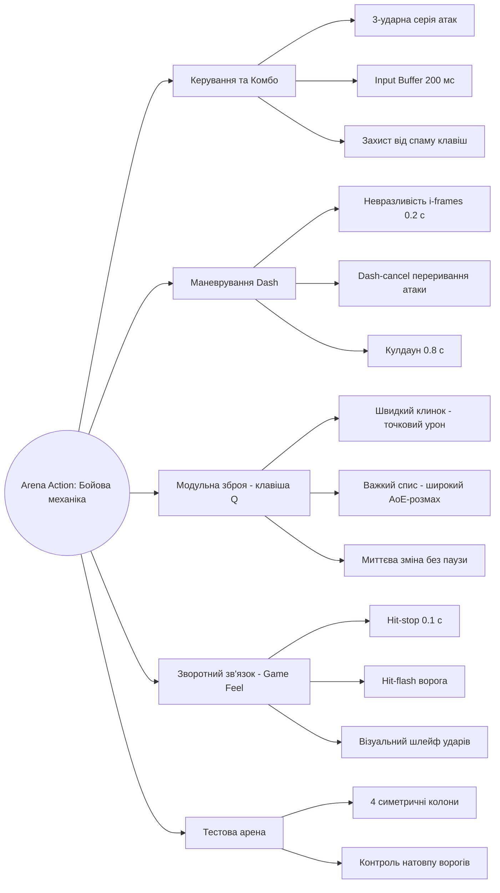
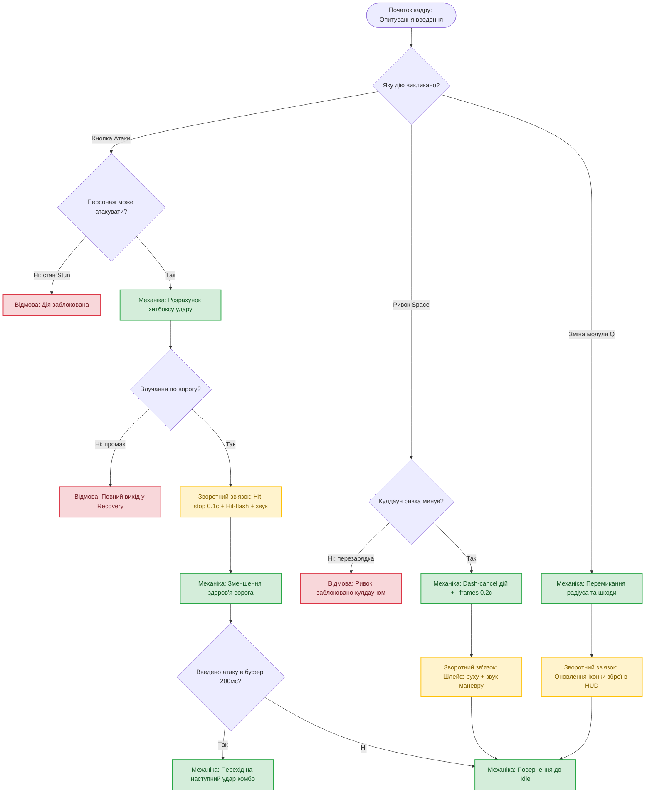
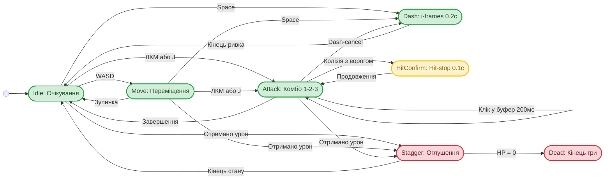

# 🎮 Arena Action — Прототип бойової механіки (Частина 1)

**Жанр та платформа:** 3D ізометричний арена-екшен для ПК  
**Фокус проєкту:** Механіка ближнього бою (3-ударне комбо, Input Buffer, Dash-cancel із кадрами невразливості i-frames та динамічна зміна модулів зброї).

🔗 **[Грати в інтерактивний веб-прототип (GitHub Pages)](./index.html)**  
🎨 **[Ескізи варіантів арени у Figma](https://www.figma.com/design/ixcG3hgPrWhBiqXqFz9IFm/nabros?node-id=0-1&p=f&t=SN0WtQbz1qesrU7N-0)**

---

## 1. Mind Map (Карта думок концепції)



---

## 2. Порівняльна таблиця з аналогами

* **Hades** (2020, PC / Консолі) — https://store.steampowered.com/app/1145360/Hades/
* **Dead Cells** (2018, PC / Консолі) — https://store.steampowered.com/app/588650/Dead_Cells/
* **Hyper Light Drifter** (2016, PC / Консолі) — https://store.steampowered.com/app/257850/Hyper_Light_Drifter/

| Критерій | Мій проєкт (Arena Action) | Hades | Dead Cells | Hyper Light Drifter |
| :--- | :--- | :--- | :--- | :--- |
| **1. Основна бойова механіка** | 3-ударні серії комбо з буферизацією введення (150–200 мс) | Швидкі комбо-серії ударів та спец-атак холодною зброєю | Серії ударів зброї ближнього бою з буферизацією | Рубаючі удари мечем із комбінацією дальніх пострілів |
| **2. Механіка ухилення** | Ривок із 0.2 с невразливості (i-frames) і dash-cancel атаки | Ривок із кадрами невразливості та атакою в русі | Перекат із вікном i-frames, що скасовує замах удару | Серійний швидкий ривок із фіксованою дистанцією |
| **3. Модифікація зброї** | Миттєва зміна модулів зброї під час бою (радіус / швидкість) без паузи | Вибір благословень богів між кімнатами | Зміна предметів у слотах та пасивних афіксів | Покращення характеристик зброї на базі |
| **4. Зворотний зв'язок (Feedback)** | Hit-flash ворога (0.1 с), hit-stop та контрастні контури атак | Ефекти hit-stop, спалахи, іскри та вібрація | Виразний hit-stop, спливаючий урон, оглушення | Лаконічний спалах пікселів, відкидання та віддача |
| **5. Простір для бою** | Компактна замкнена тестова арена з 4 колонами проти хвиль | Послідовні ізометричні кімнати з пастками | Процедурні 2D-біоми з платформами | Відкриті та напіввідкриті лабіринти в ізометрії |

**Висновок:** З *Dead Cells* та *Hades* адаптовано буферизацію введення та переривання анімації удару ривком (*dash-cancel*). Відмінність проєкту — динамічна заміна модулів зброї на льоту однією клавішею без зупинки бою.

---

## 3. Блок-схема обробки дій гравця

* **Зелений** — механіка; **Жовтий** — зворотний зв'язок; **Червоний** — стани відмови.



---

## 4. Псевдокод ігрового циклу

```javascript
while (player.isAlive) {
    input = readPlayerInput();
    if (input.dash && dashCooldown <= 0) {
        triggerDash(duration = 0.2, iFrames = true); // ривок з невразливістю
        dashCooldown = 0.8;
    } 
    else if (input.attack && player.canAttack) {
        hitbox = weaponModule.calculateArea();
        if (hitbox.intersects(enemies)) {
            applyFeedback(HitStop(0.1), HitFlash(), SoundEffect());
            damageEnemies(weaponModule.baseDamage);
            comboBufferTimer = 0.2; // вікно для введення наступного удару
        }
    }
    if (input.switchModule) weaponModule.swapNext();
    updateCooldownsAndTimers();
}
```

---

## 5. Діаграма станів (FSM)

* **Зелений** — робочі стани механіки; **Жовтий** — стан зворотного зв'язку; **Червоний** — стани відмови.



---

## 6. Ескізи 3 варіантів компонування арени (Top-down)

* **Варіант 1 (Відкрита кругла арена):** відхилено через монотонний біг по колу (кайтинг).
* **Варіант 2 (Арена з 4 колонами — ОБРАНО):** колони дозволяють розбивати групу ворогів під AoE-модуль та використовувати ривок за укриття.
* **Варіант 3 (Т-подібний коридор):** відхилено через блокування персонажа в глухих кутах.

🎨 **[Переглянути ескізи 3 варіантів арени у Figma](https://www.figma.com/design/ixcG3hgPrWhBiqXqFz9IFm/nabros?node-id=0-1&p=f&t=SN0WtQbz1qesrU7N-0)**

---

## 7. Джерела, ліцензії та академічна доброчесність

1. **Код бойової системи, State Machine та веб-прототип (`index.html`):** створено мною.
2. **Схеми, діаграми станів та ескізи арени ([Figma](https://www.figma.com/design/ixcG3hgPrWhBiqXqFz9IFm/nabros?node-id=0-1&p=f&t=SN0WtQbz1qesrU7N-0)):** створено мною (Mermaid / SVG).
3. **Шрифт інтерфейсу:** системний стек sans-serif / Roboto (Google Fonts, Apache License 2.0 — https://fonts.google.com/specimen/Roboto).
4. **Цільовий рушій:** Unity (Unity Personal License — https://unity.com).
5. **Використання генеративного ШІ (Google Gemini):** використано для структурування текстового опису, шаблонів діаграм Mermaid та налагодження обробки клавіш `KeyboardEvent.code` у веб-прототипі. Таймінги механік (i-frames 0.2 с, кулдаун 0.8 с, буфер 200 мс) та логіку модулів налаштовано вручну.
